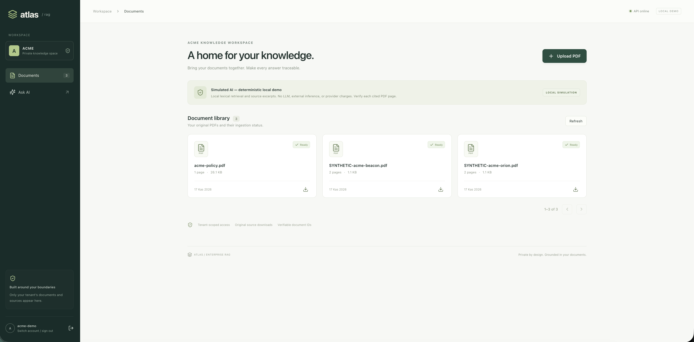
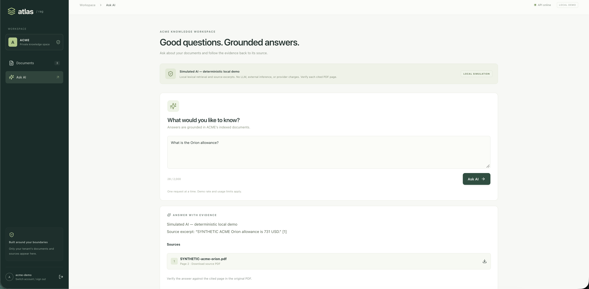
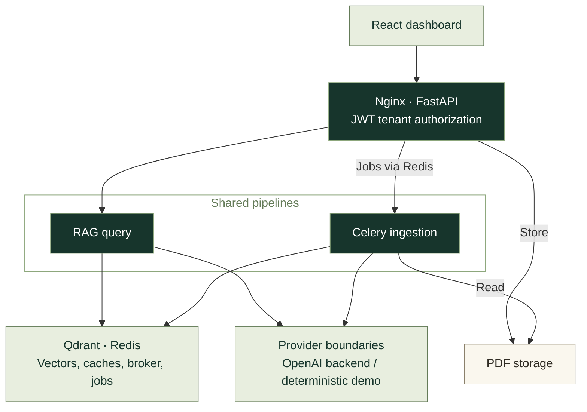

<div align="center">

# Atlas
### Enterprise RAG Platform

Turn tenant-owned PDFs into answers you can trace back to the source.

[](docs/architecture.md#technology-stack)
[](docs/demo-dashboard.md)
[](docs/demo.md)

[Explore](#application-screenshots) · [Quick start](#getting-started) · [Architecture](#high-level-architecture) · [Documentation](docs/README.md)

</div>

Atlas combines hybrid retrieval, asynchronous ingestion and citation validation in
an authenticated React workspace. Upload a PDF, follow its indexing progress, ask a
question and download the cited source to check the answer.

The **free localhost demo** uses the real pipeline with clearly labeled deterministic
source excerpts, without LLM inference. The original **OpenAI backend** is configured
separately; **Ollama was evaluated experimentally and is not integrated**.

## Application screenshots

**Document workspace** — tenant-owned PDFs and ingestion status.



**Ask AI** — a deterministic answer with its source PDF and page-2 citation.



Manual captures of the running deterministic demo. [CI validation gallery](docs/demo-dashboard.md#verified-application-gallery) · [Image provenance](docs/images/README.md)

## Key Features

- **Tenant isolation:** JWT-derived identity across retrieval, caching, jobs and downloads.
- **Hybrid search:** BM25 + vectors, Reciprocal Rank Fusion, reranking and MMR.
- **Verifiable citations:** trusted source IDs and validation of generated and cached answers.
- **Safe PDF ingestion:** Celery jobs, idempotent uploads, bounded validation and ownership checks.
- **Bounded API resources:** body limits, deadlines, concurrency admission, rate limits and quotas.
- **Responsive dashboard:** document filtering, status polling and authenticated source access.

## High-Level Architecture



Only the demo frontend is exposed on localhost. Backend services and persistent
volumes are isolated from existing local data. [Full system, RAG and ingestion diagrams](docs/architecture.md#demo-system-topology).

## Getting Started

Requires **Git, Docker Compose v2 and Python 3.13** for credential setup. Node builds
inside the image. A busy 8 GB laptop can be memory-constrained; Linux CI is verified.

```sh
git clone https://github.com/iremdinc22/enterprise-rag-platform.git
cd enterprise-rag-platform
```

For a fresh installation, first follow [private credential setup](docs/demo.md#first-startup)
to create `.env.demo` and `.env.demo.auth` with your own signing secret and passwords.
Check port **18030** and project **enterprise-rag-demo** are available; preserve any
existing configuration and volumes. Then select the deterministic demo explicitly:

```sh
demo() {
  DEMO_PROVIDER_MODE=deterministic COMPOSE_PARALLEL_LIMIT=1 docker compose \
    --env-file .env.demo --env-file .env.demo.auth -f compose.demo.yaml "$@"
}
demo config --quiet
demo build api
demo build frontend
demo up -d --no-build --wait qdrant redis
demo run --rm --no-deps api python -m src.demo.run init-collection
demo up -d --no-build --wait
```

Open **http://127.0.0.1:18030** and log in as **acme-demo** or **globex-demo** with
the passwords you chose. Upload a text-based PDF, wait for **Ready**, then ask a
question using source wording. Switch accounts to explore isolated workspaces.

Stop with `demo stop` to preserve data; never use `down -v`. The default provider
mode is `disabled` (query/upload return safe 503); the demo rejects OpenAI/Ollama
switches. See [demo setup](docs/demo.md), [usage](docs/demo.md#demo-walkthrough) and
[original OpenAI deployment](docs/deployment.md) for complete instructions.

## Testing & Validation

**377 consolidated successful test results**, plus **21 additional HTTP and
authorization controls** (12 HTTP groups + 9 authorization/session controls).
These totals span multiple validation stages, not a single CI run.

The [Atlas Demo E2E run](https://github.com/iremdinc22/enterprise-rag-platform/actions/runs/44090728527)
passed in **4m 28s**: fresh Docker builds, five healthy services, **18 Docker E2E
scenarios** and **2 Playwright tests**, including real upload/query/download flows.

[Full results and tested commit](docs/final-validation.md) · [Test commands and manual workflow execution](docs/testing.md)

## Engineering Decisions

Atlas prioritizes tenant boundaries, citation integrity and bounded failure behavior.
Replacement data is validated before deletion; document replacement itself remains
non-atomic. Process-local quotas protect resources, not provider spending.

Ollama models were benchmarked on an M2 with 8 GB RAM. Faster inference did not
offset citation, abstention and memory-reliability limitations, so integration was
deferred. [Decision narrative](docs/local-llm-decision-summary.md) · [Benchmark evidence](docs/local-llm-benchmark.md).

**Release scope: localhost portfolio demo.** Deterministic retrieval does not
establish real LLM quality or production readiness. [Known limitations](docs/architecture.md#known-limitations).

## Documentation

[Documentation index](docs/README.md) · [Architecture](docs/architecture.md) ·
[API](docs/api.md) · [Dashboard](docs/demo-dashboard.md) ·
[Uploads and jobs](docs/demo-uploads.md) · [Deployment](docs/deployment.md) ·
[Deterministic provider](docs/demo-deterministic.md) · [Testing](docs/testing.md) ·
[Final validation](docs/final-validation.md) · [Engineering decisions](docs/architecture.md#engineering-decisions-and-trade-offs)
