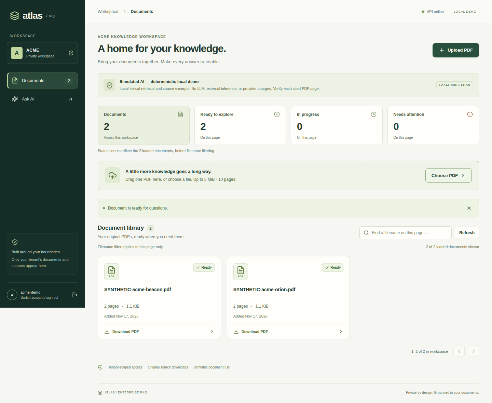
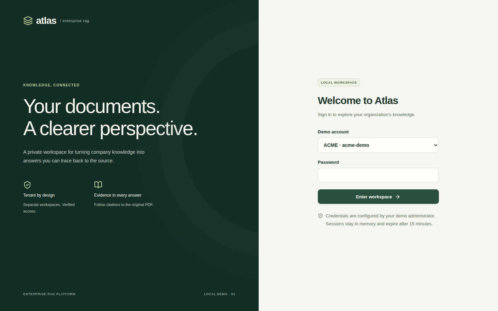
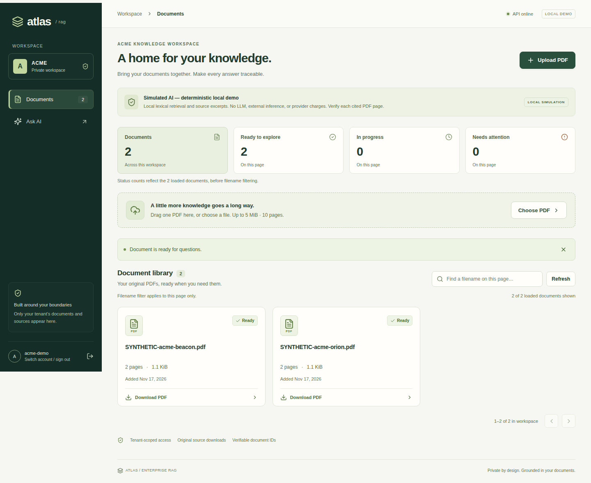
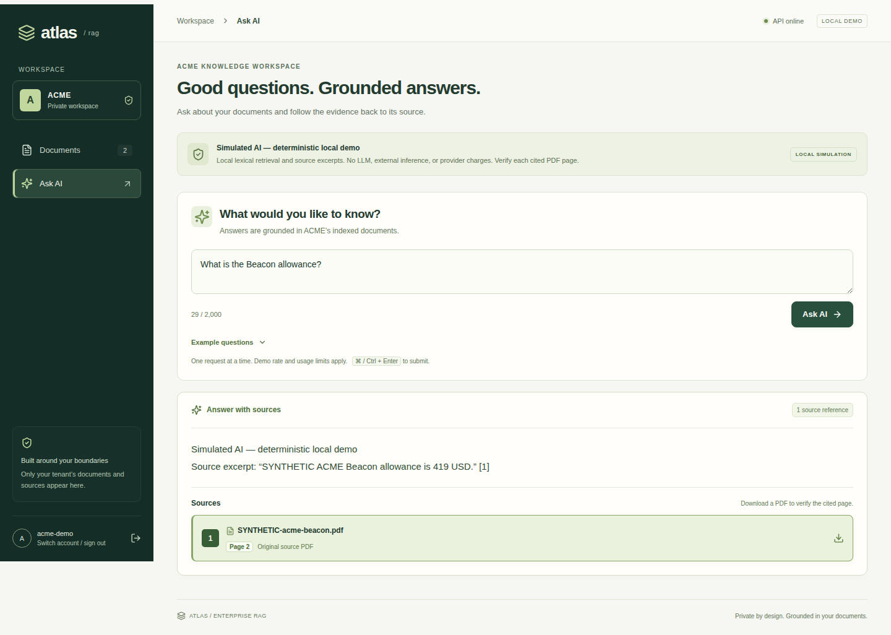
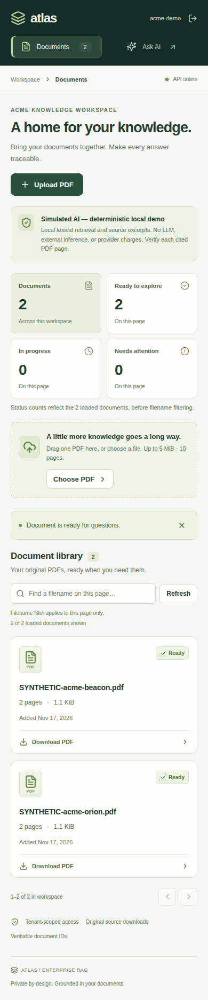
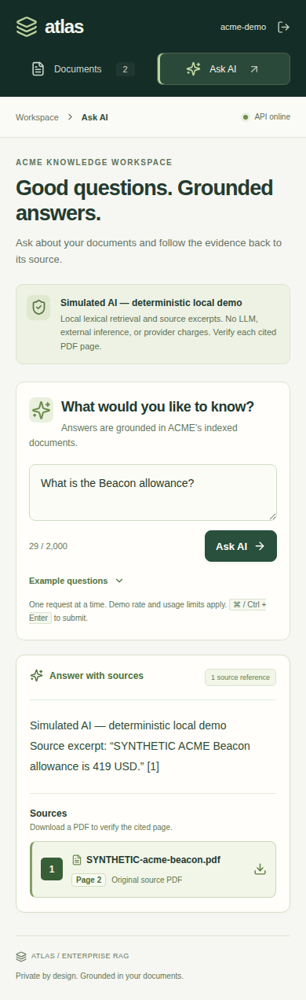
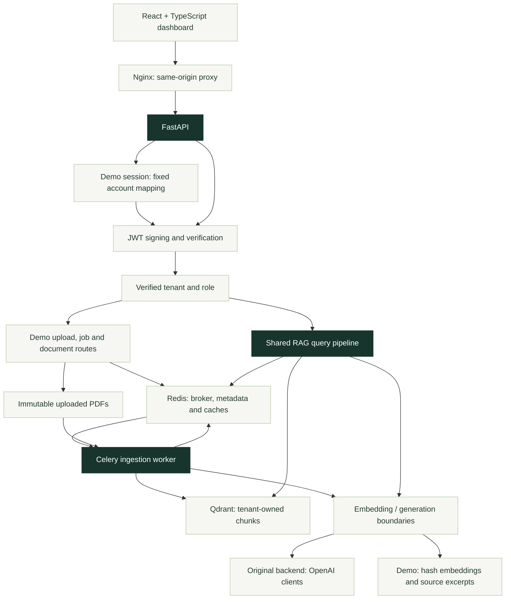
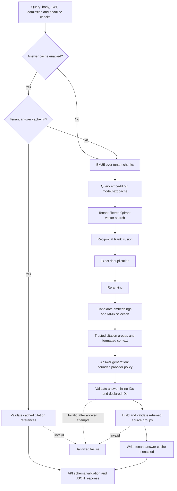
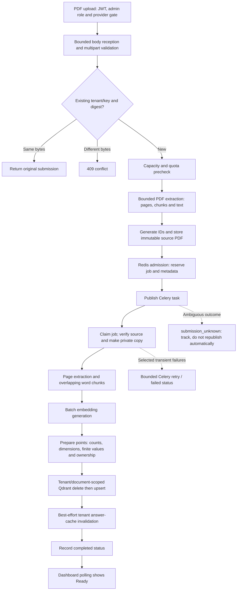

# Atlas — Enterprise RAG Platform

[](#technology-stack)
[](#technology-stack)
[](#getting-started)
[](docs/final-validation.md)

**From PDF upload to source-cited answers, within authenticated tenant workspaces.**

Atlas is a full-stack retrieval-augmented generation platform that combines hybrid
search, asynchronous document processing and citation validation behind a React
dashboard. It demonstrates the engineering around RAG: tenant isolation, bounded
resource use, safe ingestion and verifiable end-to-end workflows.

**Run the free localhost demo:** real PDF ingestion, Celery, Qdrant and retrieval,
with clearly labeled deterministic source excerpts instead of LLM inference.
The original OpenAI backend is a separate configuration; Ollama was evaluated
experimentally and is not integrated.

[Getting started](#getting-started) · [Architecture](#system-architecture) ·
[API](#api-reference) · [Validation](docs/final-validation.md) ·
[Engineering decisions](#engineering-decisions-and-trade-offs)

## Engineering highlights

- **Isolation across the stack:** verified JWT claims scope retrieval, cache keys,
  background jobs and source downloads.
- **Evidence-aware answers:** hybrid search, reranking/MMR and trusted citation
  metadata connect responses to real document pages.
- **Failure-conscious ingestion:** idempotent uploads, bounded preparation and
  ownership checks protect document processing.
- **Reproducible validation:** isolated Docker and browser workflows complement
  **377 consolidated test results**, with [published release evidence](docs/final-validation.md).

## Application screenshots

Real application captures from the [Docker/browser validation run](https://github.com/iremdinc22/enterprise-rag-platform/actions/runs/44090728527),
using synthetic PDFs with simulation labels preserved. [Image provenance](docs/images/README.md).



<details>
<summary>Login, document library and cited answer</summary>





</details>

<table>
<tr>
<td align="center"><strong>Mobile documents</strong><br></td>
<td align="center"><strong>Mobile answer and evidence</strong><br></td>
</tr>
</table>

## Key features

- **Authenticated workspaces:** JWT-derived tenant identity, employee/admin roles,
  tenant-filtered retrieval and authorized document/job access.
- **Hybrid retrieval:** BM25 and dense search combined through Reciprocal Rank
  Fusion, exact deduplication, reranking and Maximal Marginal Relevance (MMR).
- **Citation integrity:** trusted structured source IDs, bounded generation retry,
  final response checks and citation validation on cached answers.
- **Background ingestion:** page-aware PDF parsing, overlapping chunks, embedding
  preparation, Qdrant ownership checks and Celery job tracking.
- **Secure demo document access:** bounded PDF uploads, idempotency keys,
  server-generated IDs, tenant-scoped listing and authenticated downloads.
- **Resource protection:** byte-counted request limits, deadlines, bounded query
  admission, rolling rate limits and process-lifetime demo query quotas.
- **Inspectable execution:** OpenTelemetry spans, Redis caches, provider token/cost
  accounting in the OpenAI path, evaluation utilities and isolated integration tests.
- **Responsive dashboard:** filename filtering on the loaded page, drag-and-drop
  upload, status polling, source cards and explicit simulated-provider feedback.

## Getting started

### Free deterministic localhost demo

Requirements: Git, Docker Engine/Desktop with Compose v2, Python 3.13 for the
credential helper, and sufficient available memory/disk. Node is built inside the
frontend image. The final Linux CI run passed; resource pressure can still prevent
comfortable operation on a busy 8 GB laptop. See [demo configuration](docs/demo.md).

Use these commands for a **fresh installation**. Existing private env files,
containers, collections and volumes must not be overwritten or reset. Check port
18030 and the `enterprise-rag-demo` project before startup. Choose a different
port in a new configuration if needed.

```sh
git clone https://github.com/iremdinc22/enterprise-rag-platform.git
cd enterprise-rag-platform

# Exclusive creation: refuses to overwrite an existing file. No secret is printed.
python3 - <<'PY'
import os, secrets
fd = os.open('.env.demo', os.O_WRONLY | os.O_CREAT | os.O_EXCL, 0o600)
with os.fdopen(fd, 'w') as stream:
    stream.write('DEMO_JWT_SECRET=' + secrets.token_urlsafe(48) + '\n')
    stream.write('DEMO_PORT=18030\nDEMO_PROVIDER_MODE=disabled\n')
PY

# Choose your own passwords; interactive input is not echoed.
python3 -m src.demo.passwords --output .env.demo.auth

demo() {
  DEMO_PROVIDER_MODE=deterministic COMPOSE_PARALLEL_LIMIT=1 docker compose \
    --env-file .env.demo --env-file .env.demo.auth -f compose.demo.yaml "$@"
}

demo config --quiet
demo build api
demo build frontend
demo up -d --no-build --wait qdrant redis
demo run --rm --no-deps api python -m src.demo.run init-collection
demo up -d --no-build --wait
demo ps
```

Open **http://127.0.0.1:18030**. Sign in as `acme-demo` or `globex-demo` using the
password you chose for that account. There are no published default passwords.
The private files are ignored by Git; never share or commit them.

Stop only this project while preserving its data:

```sh
demo stop
```

Do not use volume-deletion flags or global cleanup commands. For a pre-existing
installation, reuse its private configuration and follow the [demo guide](docs/demo.md)
instead of rerunning credential generation or copying another corpus.

### Provider configurations

| Configuration | Behavior |
| --- | --- |
| Demo `disabled` — default | Login and existing document access; query/upload return safe 503 |
| Demo `deterministic` — explicit opt-in | Local hash embeddings, lexical retrieval/reranking and source excerpts; no paid inference |
| Original OpenAI backend | Separate normal API/worker configuration with provider credentials and compatible indexed data |

The demo rejects `openai` and `ollama` modes. For the original backend, use the
[deployment guide](docs/deployment.md) and private `OPENAI_API_KEY`/`JWT_SECRET_KEY`
configuration. Its local API commonly uses port 8001; no demo session/upload route
is added to that entrypoint. Provider queries/ingestion may incur charges and must
be invoked intentionally. Never reuse incompatible embeddings in a collection.

## Demo usage

1. Log in to one tenant and upload a small, text-based PDF using the chooser or
   drag-and-drop. Keep its wording available for a question.
2. Wait for the Celery job to reach **Ready**. Failed or uncertain submissions show
   safe feedback; do not repeatedly resubmit an uncertain operation.
3. Ask a question using words present in a source sentence. Read the simulated
   excerpt and click its source card to download the authorized PDF and verify
   the page. Paraphrases and synonyms may produce no evidence.
4. Switch accounts to demonstrate separate libraries and evidence. The frontend
   clears session-owned documents, queries, polling and download state.

For a predictable first test, create a PDF sentence such as “Orion allowance is
731 USD.” and ask “What is the Orion allowance?” The example is user-created
synthetic content, not a bundled corpus or a hardcoded answer. Public query
responses do not expose cache HIT/MISS, token usage or cost metrics.

## System architecture

The **demo HTTP topology** below reuses the shared RAG/ingestion core. Login,
upload, job and document routes are demo-only adapters; the original OpenAI
deployment exposes the normal query API. Providers are selected at process startup.



The standalone demo Compose project publishes only the frontend on
`127.0.0.1:18030`. API, worker, Redis and Qdrant use an internal network. Upload,
vector, Redis and model-cache volumes are project-scoped. Redis separates broker
DB 0, job metadata DB 1 and cache DB 2. [Detailed architecture](docs/architecture.md).

## RAG pipeline

Tenant-scoped BM25 retrieval runs before query embedding and vector search. Query
embeddings use a model/text cache; candidate batch embeddings for MMR bypass it.



The OpenAI path uses a CrossEncoder and structured generation with at most two
citation-validation attempts and 500 output tokens per attempt. The deterministic
path substitutes lexical reranking, hash embeddings and one bounded source-excerpt
attempt. It abstains when no retrieved sentence matches its lexical rules.
Citation checks enforce source consistency; semantic faithfulness and prompt
injection remain [limitations](#known-limitations).

## Asynchronous document ingestion

The browser sends one authenticated PDF and a UUID `Idempotency-Key`. The tenant
comes from the verified JWT, while document/job IDs are generated server-side.
Same tenant/key/file bytes return the original submission; this is not global
file deduplication. Different keys can create separate documents.



The demo refuses to overwrite an already indexed document; every new submission
gets a new ID. The shared ingestion core still uses **non-atomic delete-then-upsert**
replacement. Validation precedes deletion, but write failures and concurrent
writers can still leave partial results. Redis admission and Celery publishing
are not one transaction. [Upload and job contracts](docs/demo-uploads.md).

## Multi-tenancy and security

Tenant IDs are taken exclusively from verified JWT claims. Retrieval filters,
Qdrant ownership fields, answer cache keys and demo metadata retain tenant scope.
Foreign document/job requests return the same 404 responses as missing resources.
Identifiers use a shared strict policy without silently changing their values.

Demo sessions map `acme-demo` and `globex-demo` to their tenant/admin roles on the
server. Passwords are verified against scrypt hashes; JWTs expire after 15 minutes
and remain in frontend memory. Signing/provider secrets never enter the frontend
bundle. Upload storage uses generated document directories, validated filenames
and no-follow file access. Responses and logs avoid sensitive request content.

| Default protection | Limit |
| --- | --- |
| Query body / receive time | 32,768 bytes / 5 seconds |
| Query text / retrieval / final context | 2,000 characters / at most 10 / at most 3 |
| Active queries / total query deadline | 2 per process, no queue / 60 seconds |
| Accepted query rate | 6 per tenant and 12 globally per rolling minute |
| Query quota | 50 accepted queries per process lifetime, including cache hits/failures |
| PDF / pages / chunks / extracted text | 5 MiB / 10 / 200 / 100,000 characters |
| Upload receive / preparation / pending jobs | 15 seconds / 1 per API process / 2 globally |
| Accepted demo uploads | 10 per tenant, 20 globally; counters persist in demo Redis |

These controls bound resource use rather than provider billing. See
[API limits and errors](docs/api.md) and [deployment limitations](#known-limitations).

## Technology stack

| Layer | Technologies |
| --- | --- |
| Dashboard | React, TypeScript, Vite, Lucide, native fetch |
| API and authentication | Python 3.13, FastAPI, Pydantic v2, PyJWT, scrypt |
| Retrieval and generation | Qdrant, BM25, RRF, Sentence Transformers CrossEncoder, MMR, OpenAI |
| Background processing | Celery, Redis, pypdf |
| Observability | OpenTelemetry, request-local token and cost tracking |
| Deployment and testing | Docker Compose, nginx, unittest, Vitest, Testing Library, Playwright, GitHub Actions |

The deterministic adapters preserve pipeline/citation contracts without loading
CrossEncoder weights, downloading inference models or contacting OpenAI.

## API reference

All query/document identity comes from JWT claims, never a browser tenant field.
The demo frontend proxies these routes to the private API.

| Route | Scope and purpose |
| --- | --- |
| `POST /api/v1/demo/session` | Demo only; fixed account/password login, short-lived JWT |
| `POST /api/v1/documents` | Demo only; authenticated admin, one PDF and UUID `Idempotency-Key` |
| `GET /api/v1/ingestion-jobs/{job_id}` | Demo only; authenticated owner, sanitized job status |
| `GET /api/v1/documents?limit=20&offset=0` | Demo only; tenant library, limit 1–50 |
| `GET /api/v1/documents/{document_id}/file` | Demo only; authorized PDF attachment |
| `POST /api/v1/query` | Normal backend and demo; answer plus structured citations |
| `GET /health` | Process liveness; demo adds provider-mode metadata |
| `GET /ready` | Configured Qdrant collection availability, not provider readiness |
| `GET /docs` | FastAPI Swagger UI on the normal API's selected port |

[Query schemas and HTTP errors](docs/api.md) · [Session contract](docs/demo.md#demo-session-api) ·
[Upload/job/document contracts](docs/demo-uploads.md)

## Testing and CI/CD

The manual validation workflow performs no deployment. The approved
[Atlas Demo E2E run](https://github.com/iremdinc22/enterprise-rag-platform/actions/runs/44090728527)
completed in **4 minutes 28 seconds** on standard GitHub-hosted Ubuntu.

| Consolidated validation | Passed |
| --- | ---: |
| Backend regressions | 274 |
| Generation/retrieval evaluation tests | 30 |
| Frontend regressions | 35 |
| CI helper/security tests | 18 |
| Docker E2E scenarios | 18 |
| Playwright browser E2E tests | 2 |
| **Total test results** | **377** |

These are consolidated results from multiple validation stages, **not 377 tests
executed in one Actions run**. The run additionally passed **12 grouped HTTP
checks** and **9 authorization/session controls**, counted separately from tests.
It built fresh images, verified five healthy services and frontend provenance,
and exercised real deterministic upload/query/download flows with synthetic data.

To run the existing workflow manually after reviewing the intended revision:
**GitHub → Actions → Atlas Demo E2E → Run workflow**. It has no push/PR trigger,
uses scoped temporary infrastructure, and retains allowlisted reports/screenshots
for seven days. No provider credential or repository secret is needed. Standard
runner compute for this public repository is free; artifact storage is subject
to account allowances. [Permanent validation summary](docs/final-validation.md).

Local regression commands, test dependencies, CI safeguards and live-test approval
boundaries are in [Testing](docs/testing.md). Provider-backed evaluations are
separate from the deterministic GitHub workflow.

## Engineering decisions and trade-offs

- **Tenant identity at trust boundaries:** verified claims scope retrieval and
  cache access; strict identifiers and point ownership checks defend stored data.
- **Hybrid search:** lexical matches and dense similarity provide complementary
  rankings. Reranking/MMR add selection stages, but measured gains must be evaluated
  rather than assumed.
- **Trusted citation metadata:** document text cannot authorize fabricated source
  IDs. Cached and final answers must preserve real returned citation groups.
- **Async ingestion:** Celery keeps indexing outside query requests; bounded
  preparation rejects invalid replacement data before deletion. Publication and
  replacement are still non-atomic.
- **Isolated demo:** real service integration is retained while local adapters
  remove inference costs and model downloads. Test data never needs the local corpus.
- **Bounded operation:** upload/query limits and explicit failure states favor
  reviewable behavior over automatic submission loops or hidden fallbacks.

[Architecture and technical limits](docs/architecture.md) ·
[Local LLM decision narrative](docs/local-llm-decision-summary.md)

## Local LLM evaluation

Native Ollama with Qwen3 1.7B/0.6B Q4_K_M and Nomic Embed Text v1.5 was evaluated
on an Apple M2 with 8 GB memory. The smaller generator roughly doubled throughput
and reduced loaded model memory, but produced **0/4 valid cited answers** within
two attempts on the supported-question comparison set. Empty-context hallucinations
and a casing-sensitive embedding collision reinforced the need for broader quality
checks. The tokenizer root cause was not proven.

**Decision: defer Ollama integration.** Speed did not outweigh citation and
abstention failures.
Read the [benchmark report](docs/local-llm-benchmark.md) for measured subsets and
limitations, or the [decision summary](docs/local-llm-decision-summary.md) for the
engineering rationale. The findings do not generalize to all local models.

## Known limitations

- Deterministic answers use lexical matching and source excerpts, not reasoning,
  semantic generation or a real LLM. Hash collisions and missed paraphrases are possible.
- BM25 rebuilds its index from at most 100 tenant chunks; batch MMR embeddings
  bypass the query embedding cache. Cache invalidation is best effort.
- Document replacement is not atomic; failures after deletion and concurrent
  ingestion can leave partial results. There is no rollback/versioned publishing.
- Query quotas are process-local and reset on restart. Upload counters persist;
  neither mechanism is a distributed tenant budget or a provider spending cap.
- Citation consistency does not establish semantic faithfulness or prevent every
  prompt-injection attempt. The original backend retains documented empty-corpus
  and client-lifecycle limitations.
- Final browser evidence covers Chromium/Linux, not every browser/platform. Local
  M2 validation was resource-limited; CI success does not remove laptop memory constraints.
- Production hosting needs separate TLS, backup/recovery, secret rotation, JWT
  issuer/audience policy, revocation, tenant provisioning, distributed controls
  and operational monitoring design.

**Release scope: localhost portfolio demo. No production-readiness claim.**

## Project structure

```text
frontend/              React dashboard, typed client, component and browser tests
src/api/               Normal query API, authentication dependencies, resource limits
src/auth/              JWT helpers and roles
src/demo/              Isolated sessions, uploads, documents and local adapters
src/ingestion/         PDF parsing, chunking and embedding preparation
src/retrieval/         BM25/vector fusion, deduplication, reranking and MMR
src/citations/         Trusted source groups, context and response construction
src/vector_store/      Qdrant operations and ownership checks
src/cache/             Redis embedding/result caches
src/workers/           Celery ingestion
src/observability/     Tracing, query usage and cost estimation
tests/                 Regressions, controlled E2E, HTTP demo and CI helpers
evaluation/            Retrieval/generation metrics and historical results
docs/                  Architecture, contracts, deployment and experimental evidence
.github/workflows/     Manual Docker/browser validation
```

## Documentation

[Architecture](docs/architecture.md) · [API](docs/api.md) ·
[Deployment](docs/deployment.md) · [Demo configuration](docs/demo.md) ·
[Dashboard](docs/demo-dashboard.md) · [Uploads and documents](docs/demo-uploads.md) ·
[Deterministic provider](docs/demo-deterministic.md) · [Testing](docs/testing.md) ·
[Final validation](docs/final-validation.md) ·
[Local LLM benchmark](docs/local-llm-benchmark.md) ·
[Local LLM decision](docs/local-llm-decision-summary.md)
