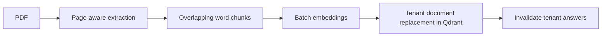
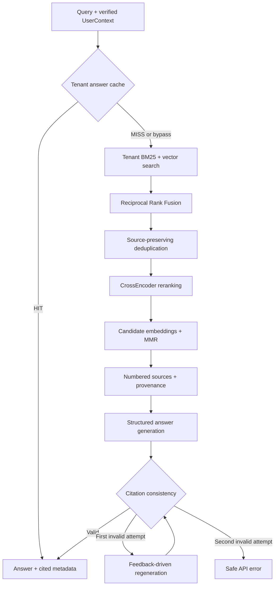

# System architecture

[Overview](../README.md) · [API](api.md) · [Deployment](deployment.md) · [Testing](testing.md)

Enterprise RAG indexes PDF documents and answers questions using evidence scoped
to a verified tenant. The same question can return ACME's 500 USD allowance or
GLOBEX's 2000 USD allowance according to authenticated identity.

## Components and boundaries

| Component | Responsibility | Source |
| --- | --- | --- |
| FastAPI | JWT boundary, schemas, query adapter, health/readiness, safe HTTP errors | [API application](../src/api/main.py) |
| Authentication | HS256 tokens, typed user context, employee/admin roles | [JWT utilities](../src/auth/jwt_handler.py), [roles](../src/auth/models.py) |
| Ingestion | PDF parsing, page-aware chunks, batch embeddings, document replacement | [Ingestion pipeline](../src/ingestion/pipeline.py) |
| Retrieval | BM25 + vector search, RRF, deduplication, reranking, MMR | [Context selection](../src/retrieval/context_selector.py) |
| Generation | Structured output, citation validation and one feedback retry | [Generator](../src/generation/generator.py) |
| Qdrant | Vectors and chunk/provenance payloads, tenant filters | [Vector store](../src/vector_store/qdrant_store.py) |
| Redis | Broker (DB 0), job states (DB 1), caches (DB 2) | [Configuration](../src/config.py) |
| Celery | Background PDF ingestion and selected transient retries | [Worker](../src/workers/celery_app.py) |
| Observability | Pipeline spans, request-scoped tokens and estimated cost | [Tracing](../src/observability/tracing.py), [usage](../src/observability/usage_tracker.py) |

The application is Python with FastAPI/Uvicorn, PyJWT, Pydantic v2, OpenAI,
Sentence Transformers, rank-bm25, NumPy, pypdf, Redis, Celery, and OpenTelemetry.
Service addresses/model names are process configuration; see [deployment settings](deployment.md#configuration).

## Document indexing

Defaults are **40 words per chunk with 8-word overlap**, not token counts. Pages
are processed independently; chunks do not cross pages. Payloads preserve
`tenant_id`, `document_id`, `filename`, `page`, `chunk_id`, and `text`. Point IDs
use UUIDv5 over `tenant_id:document_id:chunk_id`.

Re-ingestion deletes only the matching tenant/document version and inserts the
new chunks, then invalidates that tenant's answer cache. Delete and insert are
separate operations, so replacement is not atomic. PDF extraction has no OCR.

Ingestion is a trusted internal interface, not an HTTP upload endpoint. The
[admin authorization helper](../src/auth/authorization.py) exists, but ingestion
does not automatically call it. Callers must authorize input and tenant identity.
A Celery task receives a PDF path visible inside the worker, document ID, and
tenant ID. Job hashes record `queued`, `processing`, `retrying`, `completed`, or
`failed`. Selected connection/timeout/rate-limit/server errors allow three retries
after the first attempt, with exponential backoff and jitter; missing files fail
immediately. Background ingestion can incur embedding charges.

## Question answering

[`run_rag()`](../src/rag/pipeline.py) is async and coordinates the existing modules.
FastAPI awaits it directly. Default retrieval returns up to five candidates from
each branch; RRF retains up to five fused candidates. After deduplication/reranking,
MMR selects up to three contexts. BM25 and vector retrieval execute sequentially.

- **RRF** combines ranks using `1 / (60 + rank)` rather than comparing unrelated
  lexical/vector score scales. Individual ranks/scores remain available internally.
- **Deduplication** normalizes case/whitespace and merges identical text while
  retaining distinct document/page/chunk records in `sources`. It is not semantic
  deduplication.
- **CrossEncoder** defaults to `cross-encoder/ms-marco-MiniLM-L6-v2` and scores
  query/passage pairs. **MMR** balances normalized relevance and cosine similarity
  of fresh candidate embeddings, with default `lambda_value=0.5`.
- **Generation** uses `answer`, `answered`, and `citation_ids`. Factual answers
  need inline IDs matching declared IDs and supplied sources. Abstention requires
  the prescribed answer with no citations. Invalid output permits one retry with
  previous answer/validation feedback. Only cited source groups are returned.

Citation checks establish format/ID consistency, not semantic support for every
claim. Empty tenant corpora can fail during BM25 construction; empty context and
exhausted validation raise errors. The API currently returns a generic 500 for
these paths rather than converting them to a new abstention policy.

## Tenant isolation and caching

The API constructs `UserContext` only from verified JWT claims. Client-supplied
body tenant/model fields are rejected, and headers/URL parameters cannot override
the token tenant. Both employee and admin roles may query. Direct Python callers
must supply trusted context; `run_rag()` does not authenticate it again.

BM25 scrolls and vector queries filter by tenant before fusion and generation.
Document deletion also filters by tenant and document ID. Answer-cache keys carry
tenant identity; identical questions from different tenants do not share answers.

| Cache | Identity | TTL |
| --- | --- | --- |
| Query embedding | Embedding model + SHA-256 of text | 60 minutes |
| Answer | Tenant + query + generation model + retrieval/final limits + MMR weight | 30 minutes |

Query embeddings may be reused across tenants for identical text/model; they do
not contain retrieved tenant answers. Candidate/batch embeddings bypass this
cache. `use_cache=false` bypasses the answer cache only. Cache connection failures
allow computation to continue; invalidation is best effort and stale answers can
remain until TTL. Keys do not version the complete prompt/model configuration.

## Observability and cost

`RAG_TRACING_ENABLED=true` enables the existing console exporter. Pipeline tracing
includes `rag.query`, cache, retrieval, citation, generation attempts, and citation
validation spans. The performance runner uses an in-memory exporter. There is no
hosted trace storage, dashboard, alerting, or HTTP trace-context propagation.

A `ContextVar` collector tracks generation attempts, generation input/cached-input/
output tokens, embedding API calls/cache hits/input tokens, and estimated USD cost.
Usage is reset after each invocation, including early cache returns. Answer HITs
record zero new provider usage. Usage/cost live in spans, not the HTTP response.
Missing provider usage and ambiguous SDK retries cannot be fully accounted for.

[Price tables](../src/observability/costs.py) support `gpt-4.1-mini` and
`text-embedding-3-small`; they are estimates, not invoices. Normal generation has
no explicit output-token cap and uses SDK retry defaults. The [live smoke guard](testing.md#controlled-live-smoke-test)
adds isolated test controls; it does not introduce a production spending limit.

Raw provider exception text is excluded from RAG spans. The root retains a generic
ERROR status. Cache and citation diagnostics use static messages, and API errors
avoid echoing request data. Keep separate third-party debug/HTTP logging disabled
and use the documented Uvicorn `--no-access-log` option.

## Current engineering limits

BM25 rebuilds an index per query from at most 100 tenant chunks without pagination.
Synchronous Redis/reranker work can block the async event loop. Existing clients
are initialized at import/startup; the first reranker load may download weights.
Process-global async clients and repeated worker event loops need lifecycle work.
Non-atomic replacement, best-effort invalidation, empty-corpus handling, and the
small evaluation datasets remain limits. See [test scope and results](testing.md)
and [deployment boundaries](deployment.md#verified-results-and-limitations) before drawing
production reliability, throughput, or security conclusions.
