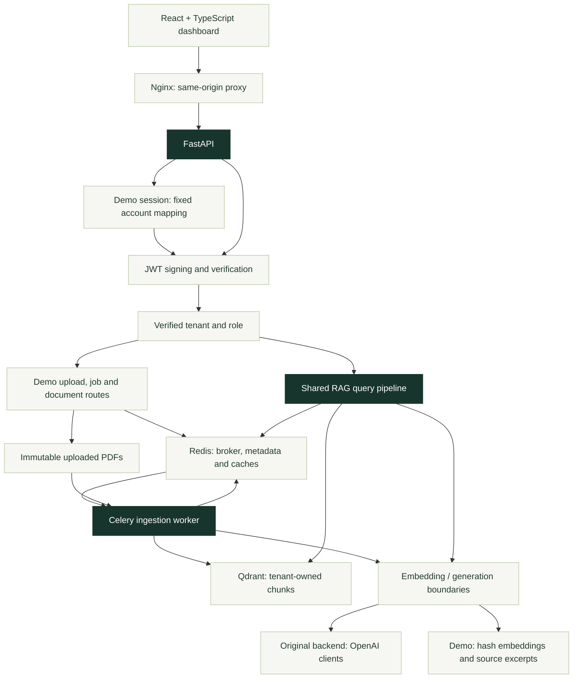
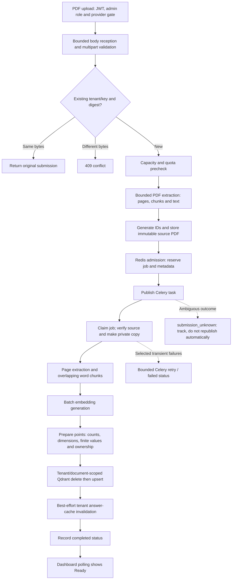
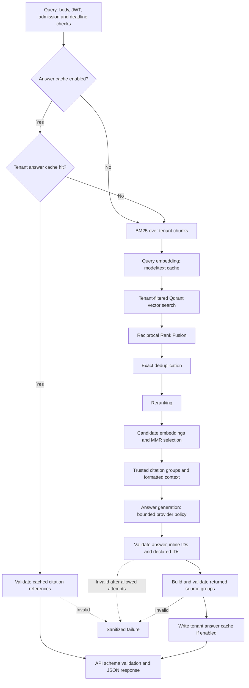

# System architecture

[Documentation index](README.md) · [Overview](../README.md) · [API](api.md) · [Deployment](deployment.md) · [Testing](testing.md)

Enterprise RAG indexes PDF documents and answers questions using evidence scoped
to a verified tenant. The same question can return ACME's 500 USD allowance or
GLOBEX's 2000 USD allowance according to authenticated identity.

## Components and boundaries

| Component | Responsibility | Source |
| --- | --- | --- |
| FastAPI | JWT boundary, schemas, query adapter, health/readiness, safe HTTP errors | [API application](../src/api/main.py) |
| Authentication | HS256 tokens, typed user context, employee/admin roles | [JWT utilities](../src/auth/jwt_handler.py), [roles](../src/auth/models.py) |
| Ingestion | PDF parsing, page-aware chunks, batch embeddings, document replacement | [Ingestion pipeline](../src/ingestion/pipeline.py) |
| Retrieval | BM25 + vector search, RRF, deduplication, reranking, MMR | [Context selection](../src/retrieval/context_selector.py) |
| Generation | Structured output, citation validation and one feedback retry | [Generator](../src/generation/generator.py) |
| Qdrant | Vectors and chunk/provenance payloads, tenant filters | [Vector store](../src/vector_store/qdrant_store.py) |
| Redis | Broker (DB 0), job states (DB 1), caches (DB 2) | [Configuration](../src/config.py) |
| Celery | Background PDF ingestion and selected transient retries | [Worker](../src/workers/celery_app.py) |
| Observability | Pipeline spans, request-scoped tokens and estimated cost | [Tracing](../src/observability/tracing.py), [usage](../src/observability/usage_tracker.py) |

The application is Python with FastAPI/Uvicorn, PyJWT, Pydantic v2, OpenAI,
Sentence Transformers, rank-bm25, NumPy, pypdf, Redis, Celery, and OpenTelemetry.
Service addresses/model names are process configuration; see [deployment settings](deployment.md#configuration).

## Demo system topology

The demo adds React/nginx, server-side sessions, uploads and document access to the
shared core. The original OpenAI entrypoint exposes the normal query API.
Provider boundaries are selected at process startup, not as an automatic fallback
or a browser-controlled switch.

The standalone demo Compose project publishes only the frontend on
`127.0.0.1:18030`. API, worker, Redis and Qdrant use an internal network. Upload,
vector, Redis and model-cache volumes are project-scoped. Redis separates broker
DB 0, job metadata DB 1 and cache DB 2.

## Document indexing

The full upload flow below is demo-specific; indexing uses the shared ingestion
core. JWT/admin authorization and idempotency apply before Celery work.

Defaults are **40 words per chunk with 8-word overlap**, not token counts. Pages
are processed independently; chunks do not cross pages. Payloads preserve
`tenant_id`, `document_id`, `filename`, `page`, `chunk_id`, and `text`. Point IDs
use UUIDv5 over `tenant_id:document_id:chunk_id`.

Re-ingestion deletes only the matching tenant/document version and inserts the
new chunks, then invalidates that tenant's answer cache. Delete and insert are
separate operations, so replacement is not atomic. Before deletion, ingestion rejects
empty replacements, mismatched embedding counts, invalid payload/ownership fields,
non-numeric or non-finite vectors, and dimensions inconsistent with the collection
schema. It constructs the complete point set using the same builder as upsert.
An unavailable or unsupported schema stops replacement before deletion.

These checks protect against invalid prepared data, not failures after deletion:
Qdrant write errors, process crashes, or the second ownership check can still leave
the previous document deleted. Concurrent ingestions can interleave; ownership
reads are not locks. Cache invalidation remains best effort, and an in-flight query
can repopulate stale results after invalidation. There is no rollback or versioned
publication. PDF extraction has no OCR.

The shared ingestion core is a trusted internal interface; the demo wraps it with
an authenticated HTTP upload boundary. The
[admin authorization helper](../src/auth/authorization.py) exists, but ingestion
does not automatically call it. Callers must authorize input and tenant identity.
A Celery task receives a PDF path visible inside the worker, document ID, and
tenant ID. Job hashes record `queued`, `processing`, `retrying`, `completed`, or
`failed`. Selected connection/timeout/rate-limit/server errors allow three retries
after the first attempt, with exponential backoff and jitter; missing files fail
immediately. Background ingestion can incur embedding charges.

## Question answering

Query embeddings have a model/text cache; batch MMR embeddings bypass it. The
OpenAI path uses CrossEncoder reranking and at most two citation-validation
attempts with 500 output tokens each. Demo adapters use hash embeddings, lexical
reranking and one bounded source-excerpt attempt, abstaining without matching
evidence. See [deterministic behavior](demo-deterministic.md).

[`run_rag()`](../src/rag/pipeline.py) is async and coordinates the existing modules.
FastAPI awaits it directly. Default retrieval returns up to five candidates from
each branch; RRF retains up to five fused candidates. After deduplication/reranking,
MMR selects up to three contexts. BM25 and vector retrieval execute sequentially.

- **RRF** combines ranks using `1 / (60 + rank)` rather than comparing unrelated
  lexical/vector score scales. Individual ranks/scores remain available internally.
- **Deduplication** normalizes case/whitespace and merges identical text while
  retaining distinct document/page/chunk records in `sources`. It is not semantic
  deduplication.
- **CrossEncoder** defaults to `cross-encoder/ms-marco-MiniLM-L6-v2` and scores
  query/passage pairs. **MMR** balances normalized relevance and cosine similarity
  of fresh candidate embeddings, with default `lambda_value=0.5`.
- **Generation** uses `answer`, `answered`, and `citation_ids`. Factual answers
  need inline IDs matching declared IDs and supplied sources. Abstention requires
  the prescribed answer with no citations. Invalid output permits one retry with
  previous answer/validation feedback. Only cited source groups are returned.

Citation checks establish format/ID consistency, not semantic support for every
claim. Empty tenant corpora can fail during BM25 construction; empty context and
exhausted validation raise errors. The API currently returns a generic 500 for
these paths rather than converting them to a new abstention policy.

## Tenant isolation and caching

The API constructs `UserContext` only from verified JWT claims. Client-supplied
body tenant/model fields are rejected, and headers/URL parameters cannot override
the token tenant. Both employee and admin roles may query. Direct Python callers
must supply trusted context; `run_rag()` does not authenticate it again.

BM25 scrolls and vector queries filter by tenant before fusion and generation.
Document deletion also filters by tenant and document ID. Answer-cache keys carry
tenant identity; identical questions from different tenants do not share answers.

| Cache | Identity | TTL |
| --- | --- | --- |
| Query embedding | Embedding model + SHA-256 of text | 60 minutes |
| Answer | Tenant + query + generation model + retrieval/final limits + MMR weight | 30 minutes |

Query embeddings may be reused across tenants for identical text/model; they do
not contain retrieved tenant answers. Candidate/batch embeddings bypass this
cache. `use_cache=false` bypasses the answer cache only. Cache connection failures
allow computation to continue; invalidation is best effort and stale answers can
remain until TTL. Keys do not version the complete prompt/model configuration.

## Observability and cost

`RAG_TRACING_ENABLED=true` enables the existing console exporter. Pipeline tracing
includes `rag.query`, cache, retrieval, citation, generation attempts, and citation
validation spans. The performance runner uses an in-memory exporter. There is no
hosted trace storage, dashboard, alerting, or HTTP trace-context propagation.

A `ContextVar` collector tracks generation attempts, generation input/cached-input/
output tokens, embedding API calls/cache hits/input tokens, and estimated USD cost.
Usage is reset after each invocation, including early cache returns. Answer HITs
record zero new provider usage. Usage/cost live in spans, not the HTTP response.
Missing provider usage and ambiguous SDK retries cannot be fully accounted for.

[Price tables](../src/observability/costs.py) support `gpt-4.1-mini` and
`text-embedding-3-small`; they are estimates, not invoices. Generation has a 500-token output cap and query SDK retries are disabled.
API query calls share a 60-second deadline with 20-second per-call allowances
and a 5-second connect cap. Ingestion retains its separate retry policy. The [live smoke guard](testing.md#controlled-live-smoke-test)
adds isolated test controls; it does not introduce a production spending limit.

Raw provider exception text is excluded from RAG spans. The root retains a generic
ERROR status. Cache and citation diagnostics use static messages, and API errors
avoid echoing request data. Keep separate third-party debug/HTTP logging disabled
and use the documented Uvicorn `--no-access-log` option.

## Current engineering limits

BM25 rebuilds an index per query from at most 100 tenant chunks without pagination.
API Redis-cache/reranker calls are offloaded to threads; cancellation waits for
active blocking work before releasing query capacity. Direct Python/worker calls
retain synchronous behavior. Stuck work can hold capacity indefinitely. Existing clients
are initialized at import/startup; the first reranker load may download weights.
Process-global async clients and repeated worker event loops need lifecycle work.
Non-atomic replacement, best-effort invalidation, empty-corpus handling, and the
small evaluation datasets remain limits. See [test scope and results](testing.md)
and [deployment boundaries](deployment.md#verified-results-and-limitations) before drawing
production reliability, throughput, or security conclusions.

## Security and resource controls

Tenant IDs are taken exclusively from verified JWT claims. Retrieval filters,
Qdrant ownership fields, answer cache keys and demo metadata retain tenant scope.
Foreign document/job requests return the same 404 responses as missing resources.
Identifiers use a shared strict policy without silently changing their values.

Demo sessions map `acme-demo` and `globex-demo` to their tenant/admin roles on the
server. Passwords are verified against scrypt hashes; JWTs expire after 15 minutes
and remain in frontend memory. Signing/provider secrets never enter the frontend
bundle. Upload storage uses generated document directories, validated filenames
and no-follow file access. Responses and logs avoid sensitive request content.

| Default protection | Limit |
| --- | --- |
| Query body / receive time | 32,768 bytes / 5 seconds |
| Query text / retrieval / final context | 2,000 characters / at most 10 / at most 3 |
| Active queries / total query deadline | 2 per process, no queue / 60 seconds |
| Accepted query rate | 6 per tenant and 12 globally per rolling minute |
| Query quota | 50 accepted queries per process lifetime, including cache hits/failures |
| PDF / pages / chunks / extracted text | 5 MiB / 10 / 200 / 100,000 characters |
| Upload receive / preparation / pending jobs | 15 seconds / 1 per API process / 2 globally |
| Accepted demo uploads | 10 per tenant, 20 globally; counters persist in demo Redis |

These controls bound resource use rather than provider billing. See
[API limits and errors](api.md) and [deployment limitations](#known-limitations).

## Technology stack

| Layer | Technologies |
| --- | --- |
| Dashboard | React, TypeScript, Vite, Lucide, native fetch |
| API and authentication | Python 3.13, FastAPI, Pydantic v2, PyJWT, scrypt |
| Retrieval and generation | Qdrant, BM25, RRF, Sentence Transformers CrossEncoder, MMR, OpenAI |
| Background processing | Celery, Redis, pypdf |
| Observability | OpenTelemetry, request-local token and cost tracking |
| Deployment and testing | Docker Compose, nginx, unittest, Vitest, Testing Library, Playwright, GitHub Actions |

The deterministic adapters preserve pipeline/citation contracts without loading
CrossEncoder weights, downloading inference models or contacting OpenAI.

## Engineering decisions and trade-offs

- **Tenant identity at trust boundaries:** verified claims scope retrieval and
  cache access; strict identifiers and point ownership checks defend stored data.
- **Hybrid search:** lexical matches and dense similarity provide complementary
  rankings. Reranking/MMR add selection stages, but measured gains must be evaluated
  rather than assumed.
- **Trusted citation metadata:** document text cannot authorize fabricated source
  IDs. Cached and final answers must preserve real returned citation groups.
- **Async ingestion:** Celery keeps indexing outside query requests; bounded
  preparation rejects invalid replacement data before deletion. Publication and
  replacement are still non-atomic.
- **Isolated demo:** real service integration is retained while local adapters
  remove inference costs and model downloads. Test data never needs the local corpus.
- **Bounded operation:** upload/query limits and explicit failure states favor
  reviewable behavior over automatic submission loops or hidden fallbacks.

[Architecture and technical limits](architecture.md) ·
[Local LLM decision narrative](local-llm-decision-summary.md)

## Known limitations

- Deterministic answers use lexical matching and source excerpts, not reasoning,
  semantic generation or a real LLM. Hash collisions and missed paraphrases are possible.
- BM25 rebuilds its index from at most 100 tenant chunks; batch MMR embeddings
  bypass the query embedding cache. Cache invalidation is best effort.
- Document replacement is not atomic; failures after deletion and concurrent
  ingestion can leave partial results. There is no rollback/versioned publishing.
- Query quotas are process-local and reset on restart. Upload counters persist;
  neither mechanism is a distributed tenant budget or a provider spending cap.
- Citation consistency does not establish semantic faithfulness or prevent every
  prompt-injection attempt. The original backend retains documented empty-corpus
  and client-lifecycle limitations.
- Final browser evidence covers Chromium/Linux, not every browser/platform. Local
  M2 validation was resource-limited; CI success does not remove laptop memory constraints.
- Production hosting needs separate TLS, backup/recovery, secret rotation, JWT
  issuer/audience policy, revocation, tenant provisioning, distributed controls
  and operational monitoring design.

**Release scope: localhost portfolio demo. No production-readiness claim.**
